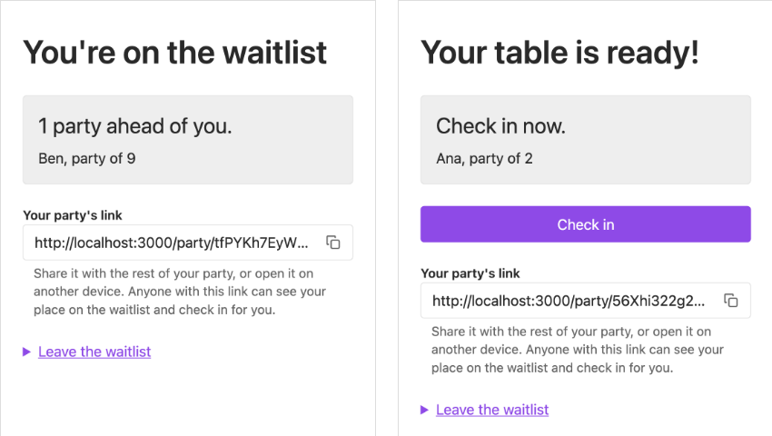

# Remote Waitlist Manager

Diners at a fully booked restaurant join a virtual waitlist from their phone, watch their place in the line update on its own, and check in when their table is ready. The assignment is at the bottom of this file.



## Quick start

You need **Git** and **Docker**, with Docker running (Docker Desktop on a Mac or Windows). Node isn't needed to run the app: the Docker image installs everything it needs.

```sh
git clone https://github.com/Gabe-Goodman/remote-waitlist-manager.git
cd remote-waitlist-manager
docker compose up --build
```

The first build takes a minute or two. Then open http://localhost:3000. From a phone on the same Wi-Fi, use your computer's IP address instead of `localhost` (for example `http://192.168.1.20:3000`).

Stop it with Ctrl+C, or `docker compose down` (the waitlist is kept in a Docker volume; `docker compose down -v` deletes it).

## Try it as two diners

The restaurant has 10 seats, and a party is served for 3 seconds per person. Use two browsers (or a normal and a private window) so each holds its own party.

1. **Browser A:** join as a party of **2**. Your table is ready at once: "Your table is ready! Check in now."
2. **Browser B:** join as a party of **9**. A holds 2 seats and 2 + 9 > 10, so B waits: "1 party ahead of you."
3. **A:** tap **Check in**. A is seated for 6 seconds ("Enjoy your meal."), then the card turns to "Thanks for dining with us." on its own. Meanwhile B, without reloading, shows "You're next. Stay close and keep this page open."
4. **B**, still without reloading: the moment A's meal ends, B's card turns to "Your table is ready!" with the Check-in button, and the tab title changes.
5. Copy **B's link** (the address bar, or "Your party's link") into browser A: A now shows B's card, and tapping Check in there checks in B. Anyone with the link can act for the party.
6. On a finished or left card, "Join the waitlist again" opens the form with the name and email filled in; the party goes to the back of the line.

Try the edges too: join twice with the same email, double-tap Join, leave the waitlist, or turn JavaScript off (every screen still works; the card updates on reload instead).

## How it works

### The rules
- **Strict order.** Walk the line from the front: every party that fits in the free seats is ready and holds its seats; the first that doesn't fit makes everyone behind it wait, even a smaller party that would fit.
- **Check-in** only when ready. A seated party frees its seats when its meal ends (3 s × party size).
- **A ready party keeps its table until it checks in or leaves.** There is no time limit (see "Known limits").
- **No duplicates:** an email can't be on the waitlist twice while its party holds a place; one browser holds one party; a double tap makes one party.
- **Never overbooked**, even when parties join or check in at the same moment.

### Storage and concurrency
The whole waitlist is **one MongoDB document**, `{ _id: "main", version, parties: [...] }`, with the line in array order. It stores only facts (who joined, checked in, left, and when); waiting, ready, in service and done are worked out from those facts and the clock on every request, so nothing needs a background job.

Every change is **read, apply a rule, save only if nobody saved in between**: `replaceOne({ _id: "main", version }, { version: version + 1, parties })`. MongoDB writes one document atomically, so if two diners save at once, one save wins and the other finds the version moved on, reads the waitlist again, reruns the rule on the fresh line and saves too, up to 10 tries (then "busy, please tap Join again"). That one check prevents lost updates, duplicates and overbooking. Why one document, its limits (16 MB, read size) and what I'd do in production are in [DECISIONS.md](DECISIONS.md).

### Pages: server-rendered, with two islands
Pattern: **Islands.** Every page is rendered on the server with React (`renderToString`), works without JavaScript, and is fast on a slow phone (TableKit's stylesheet and the page's scripts are inlined, so there's one request). Two small dependency-free scripts add interactivity:
- **the live card** (`browser/liveCard.js`) fetches the party's card every 2 seconds, one request at a time, and swaps it in when it changed; it refreshes at once when the phone is unlocked, and sets the tab title and vibrates when the table is ready;
- **the Copy button** (`browser/copyLink.js`) copies the party's link.

No React runs in the browser: the live card swaps in HTML the server rendered, so there is one renderer and nothing to hydrate.

### URLs

| Method | Path | What it does |
|---|---|---|
| GET | `/` | The join form; a browser that has a party goes to its page. `?rejoin=<token>`: the form filled in from a party whose visit is over. |
| POST | `/parties` | Join (the form). On success, to the party's page. |
| GET | `/party/:token` | The party's own page: its state, its link, Check in and Leave. The address bar is the link to share. |
| GET | `/party/:token/card` | The card alone, for the live update. |
| POST | `/party/:token/check-in` | Check the party in, if its table is ready. |
| POST | `/party/:token/leave` | Take the party off the waitlist. |
| GET | `/health` | 200 once MongoDB answers. |

### Code

```
browser/                     what runs in the diner's browser, inlined into the page
├── page.css                 the page's own CSS, on top of TableKit's classless stylesheet
├── copyLink.js              the Copy button
└── liveCard.js              keeps the card up to date
src/                         what runs on the server
├── domain/waitlist.ts       the rules: pure functions of (waitlist, now); no database, clock or HTTP
├── services/                use cases: load → rule → save if unchanged → retry on conflict
├── storage/                 MongoDB only: the one versioned document
├── routes/                  HTTP only: waitlistRoutes.ts lists the URLs, waitlistHandlers.ts says what each does
├── views/                   render only: React components that return finished HTML; messages.ts holds every word a diner reads
└── server.ts                wiring: settings, MongoDB, the real clock, graceful shutdown
e2e/                         Playwright journeys in a phone-sized browser
```

Dependencies point one way: routes → services → storage; the domain is pure rules; views only render. Stack: Node 22, TypeScript (strict), Hono, React 19 (server only), MongoDB 9.0.4 with the official driver, TableKit CSS, Vitest, Playwright, Docker Compose.

## Requirements and the tests that cover them

| Requirement | Tests |
|---|---|
| Join with name, email and party size | domain "validating the join form"; routes "joins and sends the diner to their page", "keeps what the diner typed and shows each error next to its field"; e2e "joins the waitlist, lands on the party's page and stays there after a reload" |
| See your place across browser sessions | routes "shows a party's page at its link in another browser, and remembers it there"; e2e "views the party from another browser session" |
| Check-in button when the party is ready | domain "makes every party at the front ready while they fit"; routes "shows a party whose table is ready the Check-in button"; e2e "shows the Check-in button the moment the table is ready, without a reload" |
| On check-in: off the queue, seats taken, service starts | domain "checks in a party whose table is ready", "holds the seats it checked in with until its service ends", "serves a party for 3 seconds per person" |
| Next party gets Check-in when seats free up; otherwise waits | domain "counts the seats of parties in service until each service ends, then frees them", "keeps everyone behind a party that doesn't fit waiting, even a party that would fit"; e2e "lets the next party check in once a service ends, and the first join again" |
| 10 seats, never overbooked | domain "never seats more people than the restaurant has"; service "checks in a party only once when it checks in twice at once" |
| Never on the waitlist twice | domain "refuses an email that is already on the waitlist"; service "lets only one of two simultaneous joins with the same email in", "lets two simultaneous submissions of the same form make one party"; routes "lands a double tap on the same party" |
| Concurrent joins | storage "refuses a save from a stale version and writes nothing", "lets only one of two simultaneous saves from the same version win"; service "lets 20 simultaneous joins in: all saved, none busy" |
| Runs with `docker compose up` | e2e "the built app starts and answers its health check" (every e2e run builds and starts the Compose image) |

Each key rule was also broken on purpose once to check that a named test fails (described in the pull requests).

## Develop

You need Node 22 (`nvm use` reads `.nvmrc`) and Docker, running.

```sh
npm install
npm run dev    # starts MongoDB in Docker, then the app on port 3000, reloading on changes
```

### Scripts

| Command | What it does |
|---|---|
| `npm run dev` | MongoDB in Docker, then the app with reload on changes |
| `npm test` | MongoDB in Docker, then all Vitest tests (unit and integration) |
| `npm run test:e2e` | builds and starts the app in Docker, then the Playwright journeys |
| `npm run typecheck` | TypeScript, for the server code and the browser scripts |
| `npm run lint` | ESLint, with type-checked rules |
| `npm run format` | Prettier |
| `npm run build` / `npm start` | compile to `dist/` / run the compiled app |

### Configuration

| Variable | Default | Used by | What it sets |
|---|---|---|---|
| `PORT` | `3000` | the app | the port the app listens on |
| `MONGO_URL` | `mongodb://127.0.0.1:27017/waitlist` | the app | the MongoDB database (Compose points it at its own MongoDB) |
| `MONGO_PORT` | `27017` | Compose | the port MongoDB is published on, if 27017 is taken |
| `MONGO_DB` | `waitlist` | Compose | the database name; the e2e tests set a fresh one per run |
| `MONGO_TEST_URL` | `mongodb://127.0.0.1:27017/waitlist_test` | `npm test` | where the integration tests create their throwaway collections |
| `BASE_URL` | `http://localhost:3000` | `npm run test:e2e` | the app Playwright tests against |

## Test

```sh
npm run typecheck                   # TypeScript, server code and the browser scripts
npm run lint                        # ESLint with type-checked rules
npm test                            # starts MongoDB in Docker, then runs Vitest
npx playwright install chromium     # once
npm run test:e2e                    # builds and starts the app in Docker, then runs Playwright
```

- **Unit tests** (`src/domain/`): the rules, as plain values in and out.
- **Integration tests** (`src/services/`, `src/storage/`, `src/routes/`): against a real MongoDB, a fresh collection per test in its own database; route tests go through the app's request handling with a controlled clock. No mocks of the database.
- **End-to-end** (`e2e/`): diner journeys in a phone-sized browser against the built Docker image, with JavaScript turned off (every screen must work without it), except the Copy button and the live card, which need it.

The e2e tests start their own copy of the app and stop if something already uses port 3000, so stop `npm run dev` or `docker compose` first.

## Troubleshooting

- **"Cannot connect to the Docker daemon":** Docker isn't running. Start Docker Desktop (or `colima start`, or `sudo systemctl start docker` on Linux), wait until it's ready, and try again.
- **Port 27017 already in use** (a local MongoDB): `MONGO_PORT=27018 docker compose up --build`. To run `npm run dev` or `npm test` against it, also set `MONGO_URL=mongodb://127.0.0.1:27018/waitlist` or `MONGO_TEST_URL=mongodb://127.0.0.1:27018/waitlist_test`.
- **Port 3000 already in use:** stop whatever uses it (often `npm run dev` or an earlier `docker compose up`). The e2e tests refuse to start rather than test the wrong app.
- **`npm install` warns about the Node version:** use Node 22 (`nvm use`). Docker doesn't care which Node you have.

## Known limits and what I'd do next

- **A no-show holds the line.** A ready party keeps its table until it checks in or leaves. Next: a host view to clear no-shows, or a check-in time limit that stores "ready since" the first time a request sees a party ready.
- **No alerts on a locked phone.** The card updates while the page is open and refreshes when the phone is unlocked; nothing reaches a locked phone. Next: an email or text when the table is ready.
- **The waitlist document only grows.** Finished parties stay in it, and every request reads all of it: fine for months of history, but the read size grows first. Next: move finished parties to a history collection, keeping only tonight's line in the document (see DECISIONS.md).
- **The link is the key to the party.** Anyone with it can see the party and check in, which is how a group shares one; it shows up in browser history. Next: email the link instead of relying on people keeping it private.
- **One app server is assumed** (one clock, one writer); several restaurants would each get their own document.

## How I worked

I built this one small pull request at a time, each a feature a diner can see (joining, finding your party again, checking in, leaving, the live card), merged only when CI was green, with phone screenshots in light and dark mode. Every change was test-first: write the test, watch it fail for the right reason, make it pass, then run typecheck, lint and every test before committing. For each key rule (no lost updates, no duplicates, no overbooking, first come first served, check-in only when ready) I broke the code on purpose once and checked that a named test failed, so I know the tests guard what they claim to.

I paired with an AI coding agent for the implementation, under the same rules: I planned and approved every change before it was committed, and every commit passed the same tests and checks.

I kept a running record of each decision and its trade-offs in [DECISIONS.md](DECISIONS.md), and using the app changed my mind more than once: I removed a check-in time limit and a countdown on the meal that added complexity without helping diners, and moved each party onto its own page so its address could be shared.

What I'd do differently: question earlier whether a feature the spec doesn't ask for is worth its complexity, and test with realistic, accumulated data from the start.

---

The assignment this project was built for:

# Remote Waitlist Manager

Remote Waitlist Manager is a full-stack application designed to handle the waitlist of your restaurant. It manages seating, queueing, and notifications for your diners. **Multiple parties** should be able to join your restaurant's waitlist **concurrently**. Instead of waiting in line to write your name on a piece of paper, you can now join the waitlist virtually and get notified when your table is ready. This will increase your restaurant's efficiency and provide a better experience for your customers.

The user flow is as follows:

- A party of diners go to their favorite restaurant. It's fully booked, but the restaurant gives the option to join a virtual waitlist accessible via browser.
- When the diner opens the app they're asked to input their name and party size.
- After joining the waitlist, they can check the app to verify if it's their turn.
- When the table is ready for them, they check-in via the app and get seated.

## Technical Requirements

Whatever stack you choose, your entire app should be runnable via `docker compose up` locally.

### Frontend

You must use one of these patterns:

1. Isomorphic SSR
2. Pure SSR/no interactivity
3. Islands

SPAs are not allowed.

You must use one of these frameworks/libs/implementations:

- Pure vanilla js with _no_ dependencies.
- React v18+

### Backend

You must use one of:

1. Ruby on Rails
2. nodejs (any framework besides next/nest)
3. golang (any framework)

### Testing

End-to-end tests must be written with Playwright.

### Database

You must use mongo db.

## Business Requirements

**Restaurant Capacity**

Hardcoded to 10 seats.

**Service Time Calculation**

Hardcoded to 3 seconds per person. Example: A party of 4 takes 12 seconds to complete the service.

**Joining the waitlist**

The diner opens the app that shows a single form with these fields:

- Name
- Email
- Party size

Submitting the form should send the api request to join the waitlist.

**Checking in and starting the service**

When the queued party is ready to begin service, the app should display a "check in" button. When clicked:

- The party is removed from the waitlist queue.
- The number of seats available should be decreased by the party size.
- The service countdown starts for that party.

Importantly, the user _must_ be able to view the state of their queued party across multiple browser sessions.

**Queue management**

When a party completes service:

- The system checks the queue for the next party.
- If the seats available are enough for the next party size, the next party’s app shows a new “Check-in” button.
- If not, wait until enough seats are available.

**Duplicate joins**

A party must never appear on the waitlist twice.

**Concurrency**

If two parties try to join the waitlist at the same time the venue must not become overbooked, provide each party with the best possible experience.

## Clarification

No further questions will be answered about the spec or takehome. Use your best engineerig skills, judgement, business acumen and product skills to craft the best user experience possible.

## Submission Guidelines

1. Create a public GitHub repository for your project.
2. Include this README in your repository, with clear instructions for setting up and running the project locally.
3. Include a brief explanation of your architecture decisions in the README or a separate document.

## Evaluation Criteria

Your submission will be evaluated based these criteria in order of importance:

1. Customer Focus: Is the user experience intuitive? Would _you_ use this application if you were a diner? _Please_ play around with your app as if you were a customer prior to submission.
2. Functionality: Does the application work as specified?
3. Code Quality: Is the code well-structured, readable, and maintainable? Add sufficient comments in places where you think it would help other contributors to onboard more quickly to understand your code.
4. Architecture: Are there clear separations of concerns and good design patterns used?
5. QA: Are you confident in the quality of your product? If you had to refactor or add new features, would you be able to do so without breaking the existing functionality? There is no guideline on how many tests you should write, what type of tests you should write, what level of coverage you need to achieve, etc. We leave it to you to decide how to ensure a level of quality that results in your customers trusting your product.

### Good luck!
